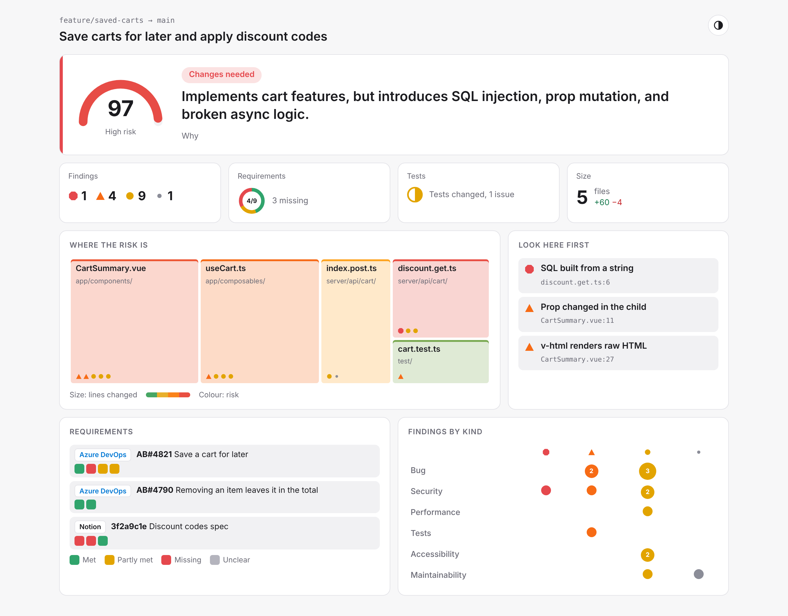

# smart-code-review

AI code review that writes a visual HTML report. The report opens on the verdict and a risk score, and you click through for more detail only where you need it.



- **Verdict first.** One headline sentence, a risk gauge and four signals: findings by severity, requirements met, tests, size.
- **Then where to look.** A map of the changed files sized by lines changed and coloured by risk, the three findings to read first, and a grid of findings by kind.
- **Then the detail.** Each finding opens to show the lines it is about and a suggested change. Each file opens to show its findings and diff. Each requirement opens to show the evidence.
- **Knows what the change was for.** Linked Azure DevOps work items, Notion pages, GitHub issues and Jira tickets are fetched, and every acceptance criterion is checked against the diff.
- **Built for JS, TS, Vue, Node and Nuxt**, with plugins for other languages.
- **One file.** The report has no external assets, so it can be attached to a CI run, emailed or opened offline.

Sample reports: [saved carts (planted problems, with requirements)](examples/saved-carts.html) and [a real change from webcontainers-demo](examples/webcontainers-tui.html). Download and open them in a browser.

## Run it

Requires Node 22.18 or later.

```bash
# This branch against main
npx github:Don191/smart-code-review

# A GitHub pull request
npx github:Don191/smart-code-review --pr https://github.com/owner/repo/pull/123

# Uncommitted changes, with requirements kept in a file
npx github:Don191/smart-code-review --working --context requirements.md --open
```

The report is written to `reviews/<branch>.html`. Run with `--help` for every option.

### AI provider

| Provider | Env var | Default model |
| --- | --- | --- |
| Gemini API (default) | `GEMINI_API_KEY` or `GOOGLE_VERTEX_API_KEY` | `gemini-3.1-flash-lite` (free tier works) |
| OpenAI | `OPENAI_API_KEY` | `gpt-5-mini` |
| Any OpenAI-compatible server | `OPENAI_API_KEY` + `OPENAI_BASE_URL` | set with `--model` |
| None | | static checks only |

Pick one with `--provider` and `--model`. Without a key the static checks still run.

## Requirements and bugs

The reviewer looks for references in the PR title, description, branch name and commit messages, and fetches the ones it has credentials for.

| Source | Finds | Env vars |
| --- | --- | --- |
| Azure DevOps | `AB#1234`, work item URLs | `AZURE_DEVOPS_ORG`, `AZURE_DEVOPS_PAT` |
| Notion | `notion.so` and `notion.site` links | `NOTION_TOKEN` (share the page with the integration) |
| GitHub Issues | `#12`, `owner/repo#12`, issue URLs | `GITHUB_TOKEN` (optional for public repos) |
| Jira | `PROJ-123`, browse URLs | `JIRA_BASE_URL`, `JIRA_EMAIL`, `JIRA_API_TOKEN` |

Acceptance criteria come from the work item's acceptance criteria field, or from checklists, bullet lists and Given/When/Then lines in the text. Bugs bring their repro steps. Each criterion is marked met, partly met, missing or unclear, with the evidence.

You can also pass requirements in with `--context`, as Markdown (one `#` heading per item, bullets for criteria) or JSON. This is how an agent that already has Notion or Azure DevOps tools hands over what it found without this package holding any tokens. See [skill/SKILL.md](skill/SKILL.md).

## Checks for JS, TS, Vue, Node and Nuxt

Static checks run first and are passed to the model so it doesn't repeat them. They cover:

- **JavaScript and TypeScript:** debugger, eval, HTML set from strings, loose equality, `forEach(async`, empty catch, unhandled promise chains, `.only` and skipped tests, hard-coded secrets, `any`, `@ts-ignore`, non-null assertions.
- **Vue:** `v-html`, `v-for` without a key, `v-if` with `v-for`, props changed in the child, destructuring that loses reactivity, images without alt text, click handlers on non-buttons.
- **Nuxt:** plain fetch in components, `process.env` in app code, unvalidated request bodies, browser globals during server render, secrets in public runtime config.
- **Node:** blocking file calls in handlers, shell commands and SQL built from strings.

Files also get a role (API route, page, composable, store, config, migration, test...) that weights their risk, and each language adds review notes to the prompt.

## Plugins

A plugin is a plain object. Add one with `--plugin ./my-plugin.js` or in code:

```ts
import { lineRule, type ReviewPlugin } from 'smart-code-review'

const go: ReviewPlugin = {
  name: 'go',
  kind: 'language',
  label: 'Go',
  color: '#00add8',
  extensions: ['.go'],
  classify: (path) => (path.endsWith('_test.go') ? 'Test' : undefined),
  rules: [
    lineRule({
      id: 'go/ignored-error',
      title: 'Error ignored',
      severity: 'minor',
      category: 'bug',
      pattern: /,\s*_\s*:?=\s*\w+\(/,
      detail: 'The error from this call is thrown away.'
    })
  ],
  guidance: 'Ignored errors, goroutine leaks, and missing context cancellation.'
}

export default go
```

`kind: 'framework'` plugins layer on top of a language (Nuxt and Node are built this way) and can switch on only when `detect(paths)` sees their kind of project. The built-in Python plugin is a small worked example.

## Connectors

A connector finds references in text and fetches them:

```ts
import type { Connector } from 'smart-code-review'

const linear: Connector = {
  name: 'linear',
  label: 'Linear',
  requires: ['LINEAR_API_KEY'],
  findRefs: (text) => [...text.matchAll(/\b([A-Z]{2,5}-\d+)\b/g)].map(m => ({ connector: 'linear', id: m[1]! })),
  fetch: async (ref, { env }) => ({ /* ...a ContextItem */ })
}
```

Pass it with `review(input, { connectors: [...BUILT_IN_CONNECTORS, linear] })`.

## Use it in code

```ts
import { review, renderHtml, fromGitHubPr, gemini } from 'smart-code-review'

const input = await fromGitHubPr('https://github.com/owner/repo/pull/123')
const result = await review(input, {
  provider: gemini({ apiKey: process.env.GEMINI_API_KEY! }),
  env: process.env // tokens for the connectors
})
const html = renderHtml(result)
```

The core uses `fetch` only, so it runs in Node, serverless functions and edge runtimes. `smart-code-review/node` adds `fromGit` for local repos. The review is also embedded in the report as JSON (`<script id="review-data">`), so other tools can read it back.

## GitHub Action

```yaml
on: pull_request
jobs:
  review:
    runs-on: ubuntu-latest
    steps:
      - uses: actions/checkout@v4
        with:
          fetch-depth: 0
      - uses: Don191/smart-code-review@main
        env:
          GEMINI_API_KEY: ${{ secrets.GEMINI_API_KEY }}
          AZURE_DEVOPS_ORG: my-org
          AZURE_DEVOPS_PAT: ${{ secrets.AZURE_DEVOPS_PAT }}
        with:
          fail-on: blocker
```

The verdict and top findings go in the job summary, and the HTML report is uploaded as the `code-review` artifact.

## House rules

Put a `.smart-code-review.md` file in the repo root and it is added to the prompt, for rules like "all API routes validate input with zod".

## Develop

```bash
yarn install
yarn test        # node --test
yarn typecheck
yarn build       # writes dist/, which is committed so the package runs straight from GitHub
```

## Licence

MIT
